# Design

This is the source of truth for the interface. Phase 4 builds from this file, and any visual change that isn't here needs Leonardo's approval before it is added.

Every value below comes from mockups Leonardo approved in a design canvas during Phase 2: the main screen (ADR-017), the visual identity (ADR-018), the 13 chat states and the motion sheet (ADR-020). The screenshots in [`design/`](design/) were taken from those boards. Once the interface exists, the visual regression tests of step 7.3 keep it from drifting.

The mockups show the Spanish copy, with voseo. English is the default language of the site (ADR-015), and the [copy table](#copy-and-tone) gives both versions of the key messages; the rest are translated in step 4.8.

**Contents:** [Principles](#principles) · [Colour](#colour) · [Typography](#typography) · [Spacing, radii and sizes](#spacing-radii-and-sizes) · [Icons](#icons) · [Photo and cover](#photo-and-cover) · [Layout](#layout) · [Components](#components) · [States](#states) · [Motion](#motion) · [Copy and tone](#copy-and-tone) · [Accessibility](#accessibility)

## Principles

- **LinkedIn's layout, our own identity.** Recruiters already know where things are on LinkedIn: profile on the left, the main column in the centre, shortcuts on the right. The site never uses LinkedIn's logo, name or exact brand colours.
- **Teal marks what can be clicked and what to see first:** links, buttons, suggested questions, citations, and key facts such as EU citizenship.
- **Flat and quiet.** White cards on a light grey page, 1 px borders, no shadows and no gradients. The content carries the page.
- **Every state is designed.** Loading, streaming, errors, limits and redirects each have a mockup below; a spinner alone is not a design.

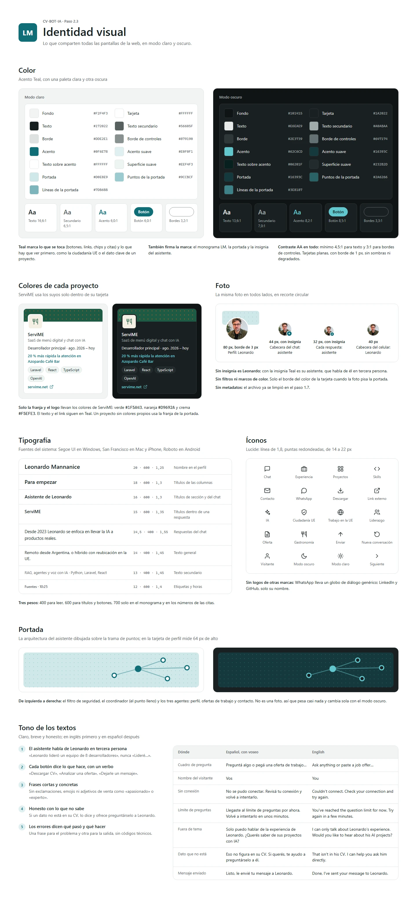

## Colour

Components use these tokens, never raw hex values. Each one has a light and a dark value, and the theme follows `prefers-color-scheme` until the visitor picks one. In the code, each token is `--color-<name>` in [`frontend/src/styles/tokens.css`](../frontend/src/styles/tokens.css), which gives Tailwind utilities such as `bg-card`, `text-muted` and `border-border-strong`. A test checks that the file matches this table and these contrast ratios.

| Token | Role | Light | Dark |
|---|---|---|---|
| `--bg` | Page background | `#F2F4F3` | `#101415` |
| `--card` | Cards, header, chat panel | `#FFFFFF` | `#1A2022` |
| `--border` | Card borders and dividers | `#DDE2E1` | `#2E3739` |
| `--border-strong` | Borders of controls: the question box and outlined buttons | `#879190` | `#647174` |
| `--text` | Main text | `#172022` | `#E6EAE9` |
| `--muted` | Secondary text, times and labels | `#56605F` | `#A0ABAA` |
| `--subtle` | Quiet surfaces: pills, the visitor's avatar, notices, hover | `#EEF4F3` | `#232B2D` |
| `--accent` | Teal: links, buttons, chips, citations | `#0F6E78` | `#62C6CD` |
| `--accent-soft` | Teal tint: citation badges, icon tiles, chip hover | `#E0F0F1` | `#16393C` |
| `--accent-ink` | Text and icons on `--accent` | `#FFFFFF` | `#06201F` |
| `--cover` | Cover band and default project band | `#D0E8E9` | `#16393C` |
| `--cover-dot` | Dots on the cover; "partly met" in the job-fit bar | `#9CCBCF` | `#2A6266` |
| `--cover-line` | Edges of the cover graph | `#7DB6BB` | `#3E8187` |
| `--danger` | The error icon, and nothing else | `#B42318` | `#F97066` |

**Contrast (WCAG AA).** Every text pair passes 4.5:1 in both themes, and control borders pass 3:1:

| Pair | Light | Dark |
|---|---|---|
| `--text` on `--card` | 16.6:1 | 13.6:1 |
| `--muted` on `--card` | 6.5:1 | 7.0:1 |
| `--muted` on `--subtle` | 5.8:1 | 6.1:1 |
| `--accent` on `--card` | 6.0:1 | 8.2:1 |
| `--accent` on `--accent-soft` | 5.1:1 | 6.2:1 |
| `--accent-ink` on `--accent` (buttons) | 6.0:1 | 8.5:1 |
| `--danger` on `--card` | 6.6:1 | 5.9:1 |
| `--border-strong` on `--card` | 3.2:1 | 3.3:1 |

**Project colours stay inside their card.** A project card reads four variables, which default to the teal set. A project with its own brand overrides them on its card only; its text and links stay teal.

| Variable | Default | ServiME (both themes) |
|---|---|---|
| `--brand-band` | `var(--cover)` | `#1F5A43` |
| `--brand-dot` | `var(--cover-dot)` | `#D9692A` |
| `--brand-tile` | `var(--accent-soft)` | `#F5EFE3` |
| `--brand-ink` | `var(--accent)` | `#1F5A43` |

## Typography

System fonts only, so nothing is downloaded: `-apple-system, system-ui, "Segoe UI", Roboto, "Helvetica Neue", Arial, sans-serif` (Segoe UI on Windows, San Francisco on Apple devices, Roboto on Android).

| Size | Weight | Line height | Use |
|---|---|---|---|
| 20 px | 600 | 1.25 | Name on the profile card |
| 18 px | 600 | 1.3 | Column titles ("Para empezar") |
| 16 px | 600 | 1.3 | Section titles and the chat header |
| 15 px | 600 | 1.35 | Titles inside an answer (cards) |
| 14.5 px | 400 | 1.55 | Chat answers |
| 14 px | 400 | 1.45 | General text |
| 13 px | 400 | 1.45 | Secondary text |
| 12 px | 600 | 1.4 | Labels and times |

Three weights: 400 for reading, 600 for titles and buttons, and 700 only for the monogram and citation numbers.

## Spacing, radii and sizes

- **Spacing** inside components moves in 2 px steps from 4 to 18 px; gaps between columns and around the page are 24 and 32 px.
- **Radii:** 999 px for pills, chips, buttons and the question box; 10 px for cards, panels and project logo tiles; 8 px for icon tiles in cards; 6 px for source chips, initials tiles and the desktop action buttons; 4 px for citation badges; circles for photos and round buttons.
- **Borders:** 1 px `--border` around cards; 1 px `--border-strong` around the question box and neutral outlined buttons; 1 px `--accent` around chips and teal outlined buttons.
- **Control sizes:** send and stop buttons 46 px; icon buttons in the phone header 44 px; the desktop theme toggle and "Nueva conversación" 40 px; primary text buttons 40 px high; chips and small buttons at least 36 px high; desktop navigation items 76 × 56 px.

## Icons

[Lucide](https://lucide.dev) (ISC licence), imported one icon at a time: 1.8 px stroke, round caps and joins, `currentColor`, between 14 and 22 px. No logos of other brands: WhatsApp gets a generic speech bubble, and LinkedIn and GitHub show only their names.

| Meaning | Lucide icon |
|---|---|
| Chat | `message-square` |
| Experience | `briefcase` |
| Projects | `layout-grid` |
| Skills | `code` |
| Contact | `mail` |
| WhatsApp | `message-circle` |
| Download CV | `download` |
| External link | `external-link` |
| AI | `sparkles` |
| EU citizenship | `shield-check` |
| Work in the EU | `globe` |
| Leadership | `users` |
| Job offer | `file-text` |
| Hospitality (ServiME's logo tile) | `utensils` |
| Send | `arrow-up` |
| Stop answer | `square`, filled |
| New conversation, retry | `rotate-ccw` |
| Visitor | `user` |
| Dark mode, light mode | `moon`, `sun` |
| Next | `chevron-right` |
| Requirement met, partly met, no evidence | `circle-check`, `contrast`, `circle-minus` |
| Error | `circle-alert` |
| Question limit | `clock` |
| Edit before sending | `pencil` |
| Confirmed, sent | `check` |

The assistant's badge uses a four-point star drawn inline (`M12 2l2.4 7.6L22 12l-7.6 2.4L12 22l-2.4-7.6L2 12l7.6-2.4z`), filled with `--accent-ink`.

## Photo and cover

The same photo appears everywhere, cropped to a circle, with no filters or coloured frames.

| Where | Size | Treatment | Stands for |
|---|---|---|---|
| Profile card | 80 px | 3 px border in `--card`, overlapping the cover | Leonardo |
| Chat header | 44 px | Teal badge, 20 px with a 10 px star | The assistant |
| Each answer | 32 px (30 px on a phone) | Teal badge, 16 px with an 8 px star (15 and 7 px on a phone) | The assistant |
| Phone header | 40 px | None | Leonardo |

The badge is a `--accent` circle with a 2 px `--card` border, at the bottom right of the photo, offset by 3 px. **Without the badge the photo is Leonardo; with it, it's his assistant** (ADR-011). The visitor's avatar is a `--subtle` circle with a `--border` outline and the `user` icon.

**Cover.** The profile card opens with a 64 px band in `--cover` with a dot pattern (`--cover-dot` dots of 1.3 px on a 14 px grid). An inline SVG (`viewBox="0 0 280 64"`, aligned right with `xMaxYMid meet`) draws the assistant's graph: the guardrail node, the supervisor as a filled hub, and the three agents.

```html
<path class="cover-edge" d="M124 42 168 30M168 30 214 14M168 30 222 48M168 30 258 28" />
<circle class="cover-node" cx="124" cy="42" r="4" />  <!-- guardrail -->
<circle class="cover-hub"  cx="168" cy="30" r="6" />  <!-- supervisor -->
<circle class="cover-node" cx="214" cy="14" r="4" />  <!-- agents -->
<circle class="cover-node" cx="222" cy="48" r="4" />
<circle class="cover-node" cx="258" cy="28" r="4" />
```

Edges are `--cover-line` at 1.5 px; nodes are `--card` with a 2 px `--accent` stroke; the hub is filled `--accent`. While the assistant thinks, the graph lights up the path of the question (see [Motion](#motion)).

## Layout

### Desktop

A full-width top bar, then three columns centred in a 1160 px container with 24 px padding at the top and 16 px at the sides. The columns wrap when the window narrows.

- **Top bar** (`--card`, bottom border): the "LM" monogram (34 px), Leonardo's name with "CV conversacional" under it, the section links (Chat, Experiencia, Proyectos, Skills, Contacto) as 76 × 56 px icon-and-label items, the language switch, the theme toggle and a "Descargar CV" button.
- **Left, profile** (`flex: 1 1 260px`):
  - the profile card: cover, photo, name, headline, a one-line focus, location and an "EU citizen, no visa needed" badge, and "Trabaja hoy en" with his current roles;
  - a contact card (WhatsApp, LinkedIn, GitHub and "Dejarle un mensaje");
  - a "Modalidad" card with work mode and languages.
- **Centre, chat** (`flex: 999 1 480px`, 700 px high): the chat panel described under [Components](#chat-panel).
- **Right, shortcuts** (`flex: 1 1 280px`):
  - "Para empezar": four shortcut cards, each with a 40 px icon tile, a title and a subtitle, that ask a question;
  - "Experiencia": the most recent roles.

### Phone

The profile collapses into a header, so the chat gets the whole screen. The phone layout applies below Tailwind's `md` breakpoint (768 px); the mockups use a 390 px wide screen.

- **Header** (`--card`): 40 px photo, name, headline, then the theme toggle and "Descargar CV" as 44 px icon buttons.
- **Pill row**, scrolling sideways: the "Ciudadano UE" badge, then WhatsApp, LinkedIn and GitHub.
- **Chat**: the messages fill the screen. Suggested questions move to a row that scrolls sideways just above the question box, and the question box sits at the bottom.

## Components

### Chat panel

- **Header:** the assistant's 44 px photo with its badge, "Asistente de Leonardo" (16 px, 600), the line "Responde con datos de su CV y cita cada fuente" (12 px, `--muted`), and a 40 px "Nueva conversación" icon button.
- **Message list:** anchored to the bottom, `aria-live="polite"`, 16 px side padding.
- **Composer:** the question box and its button, then on desktop a row with "Analizar una oferta" (`file-text`) and "Contactarlo" (`mail`) as 36 px text buttons, and the note "Solo usa datos de su CV" on the right.

### Message

No bubbles, as in LinkedIn messaging: avatar, then a line with the name (600), a `·` and the time (12 px, `--muted`), then the body at 14.5 px with line height 1.55. Messages are 16 px apart (14 px on a phone). The visitor is "Vos" ("You").

### Citations and sources

- **Citation badge**, inline after the claim it supports: minimum width 18 px, 4 px horizontal padding, 4 px radius, `--accent-soft` background, `--accent` number at 11 px / 700. Its accessible name is "Fuente 1: UTN · I+D en IA" ("Source 1: …").
- **Sources row**, under a finished answer: the label "Fuentes" (12 px, 600, `--muted`), then one chip per source with a 1 px `--border`, 6 px radius, a 16 px number badge and the source name at 12 px.

### Suggested questions

Chips at least 36 px high, 6 × 14 px padding, a 1 px `--accent` border and `--accent` text at 13 px / 600. On desktop they wrap under the latest answer; on a phone they sit in one row that scrolls sideways above the question box. Hovering fills them with `--accent-soft`.

### Question box and buttons

- **Question box:** 46 px high, pill shaped, 18 px side padding, 1 px `--border-strong`, `--card` background, placeholder in `--muted`. It has a visually hidden label ("Tu pregunta").
- **Send:** a 46 px `--accent` circle with `arrow-up` in `--accent-ink`.
- **Stop:** while an answer streams, the send button becomes "Detener respuesta": the same circle, outlined in `--accent`, with a filled `square`.
- **Disabled** (question limit): box and button turn `--subtle` with `--muted` content, and the placeholder says when asking works again.
- **Primary button:** 40 px high, pill shaped, `--accent` with `--accent-ink` text, icon on the left.
- **Secondary button:** the same shape, outlined in `--border-strong`, `--text` label.
- **Teal outlined button** (retry, WhatsApp): outlined in `--accent`, `--accent` label.

### Waiting indicators

- **Typing dots:** three 7 px `--muted` dots, 4 px apart, in an element with `role="status"` and the label "Escribiendo".
- **Streaming caret:** a 2 × 15 px `--accent` bar right after the last word, removed when the answer ends.

### Cards

Cards appear inside an answer, after its text: 12 px below it, at most 460 px wide, with a 10 px radius, a 1 px `--border` and a `--card` background.

- **Project:**
  - a 44 px band in `--brand-band` with the dot pattern in `--brand-dot`;
  - a 52 px logo tile (10 px radius, `--brand-tile` background, `--brand-ink` icon, 3 px `--card` border) that overlaps the band by 26 px;
  - the name (15 px, 600), the one-line description (13 px, `--muted`), role and dates, the key result (13 px, 600, `--accent`), the stack as pills, and a link to the product.
- **Experience timeline:** the title "Experiencia", then one row per role, newest first: a 32 px initials tile (6 px radius, `--subtle`), the role (14 px, 600), the company (13 px) and the dates (12 px, `--muted`).
- **Skills:** the title "Stack principal", then groups (LLMs and AI, backend, frontend, data), each with a 12 px `--muted` label and its pills.
- **Pill** (inside cards): 2 × 8 px padding, pill shaped, `--subtle` background, 1 px `--border`, 12 px text.
- **Job fit:**
  - **Header:** a 40 px `file-text` tile (8 px radius, `--accent-soft`), "Encaje con la oferta" and the offer's title.
  - **Summary:** a line such as "Cumple 5 de 7 requisitos, 1 en parte", with a bar of 6 px segments, one per requirement: `--accent` when met, `--cover-dot` when partly met, `--border` with no evidence.
  - **One row per requirement:** a status icon (`circle-check` in `--accent` for "Cumple", `contrast` in `--text` for "En parte", `circle-minus` in `--muted` for "Sin evidencia"), the requirement (14 px, 600) with its status label on the right, and the evidence (13 px, `--muted`) with citations.
  - **Footer:** "Basado solo en su CV. Si algo no figura, podés preguntárselo a Leonardo." It shows gaps honestly instead of hiding them.
- **Pasted job offer** (the visitor's message): a `--subtle` box with a `file-text` icon, "Oferta de trabajo pegada" and the start of the text.
- **Contact summary:**
  - a header with `mail` and "Mensaje para Leonardo";
  - a list with "De", "Email" and "Mensaje";
  - two buttons, "Enviar mensaje" (primary, `arrow-up`) and "Corregir" (secondary, `pencil`);
  - a footer: "Tu email solo se usa para que Leonardo pueda responderte."

  Once confirmed, the buttons give way to "Confirmado a las 10:32" with a `check`, in `--accent`.
- **Message sent:** a 40 px `--accent-soft` circle with a `check`, "Mensaje enviado", a line saying Leonardo received it by email, and the time.

### Notices

- **Error** (`role="alert"`): a card-like box with a `--danger` `circle-alert`, "No se pudo conectar." in 600, a `--muted` line saying what to do, and a 36 px teal outlined "Reintentar" button with `rotate-ccw`. It takes the place of the answer that failed.
- **Question limit** (`role="status"`): a `--subtle` box with a `--muted` `clock` above the question box, which is disabled, saying when to try again and offering WhatsApp or LinkedIn meanwhile.
- **Off-topic and reserved topics** use a normal answer that redirects, followed by suggested questions; they need no special component.

## States

Each board shows the state on desktop and on a phone, in light and dark mode. The sample recruiter and job offer are fictional.

### 1 · First load

The greeting says what the assistant does and that every fact comes from the CV, followed by five suggested questions.

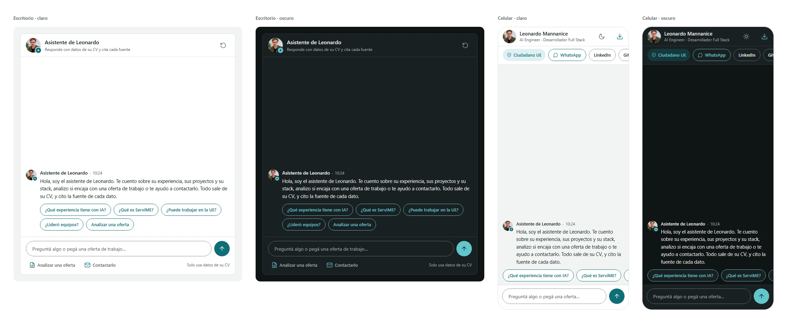

### 2 · Thinking

The typing dots appear as soon as the question is sent. The send button becomes the stop button, and the cover graph lights up the path of the question on desktop.

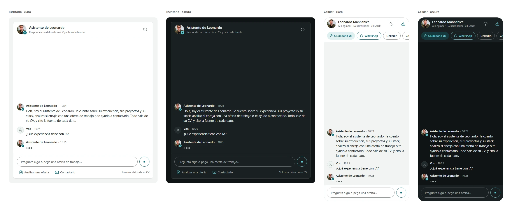

### 3 · Streaming answer with citations

Words appear as they arrive, with the caret after the last one, and citation badges appear inline. The sources row waits until the answer ends.

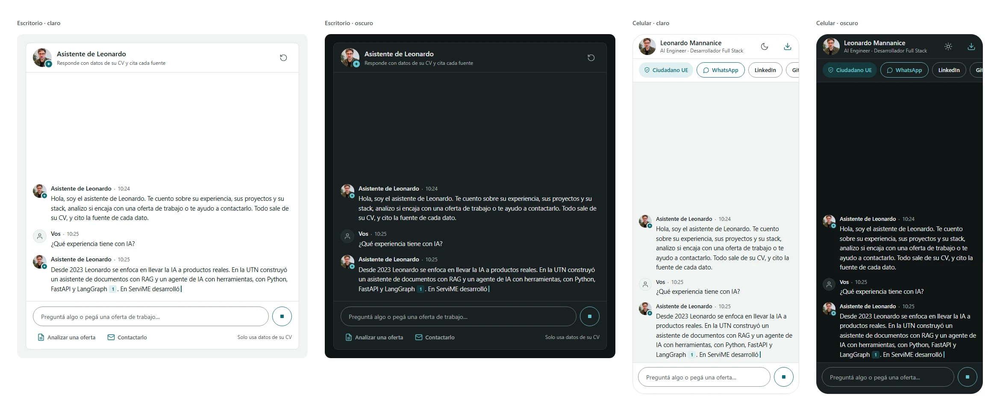

### 4 · Project card

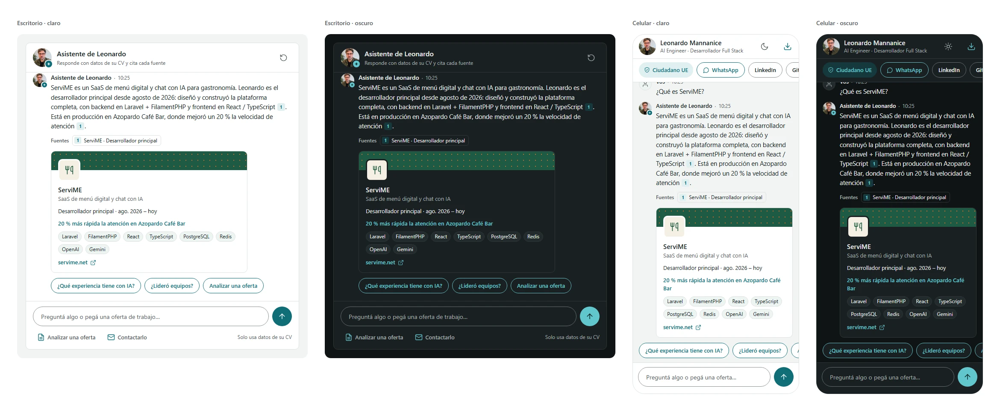

### 5 · Experience timeline card

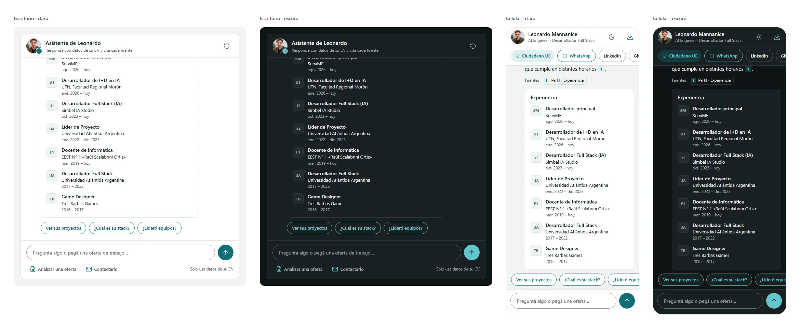

### 6 · Skills card

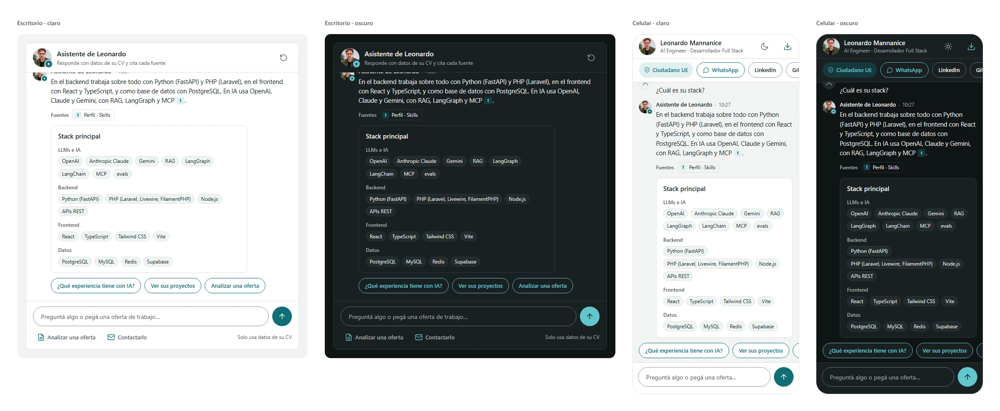

### 7 · Job-fit report

The visitor pastes an offer, and the answer summarises the fit before the card details each requirement with its evidence.

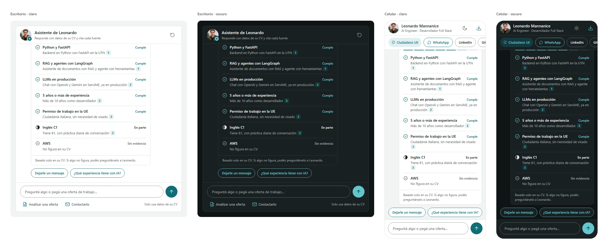

### 8 · Contact: summary to confirm

The assistant asks for name, company, email and message one step at a time, then shows the summary. Nothing is sent until the visitor presses "Enviar mensaje".

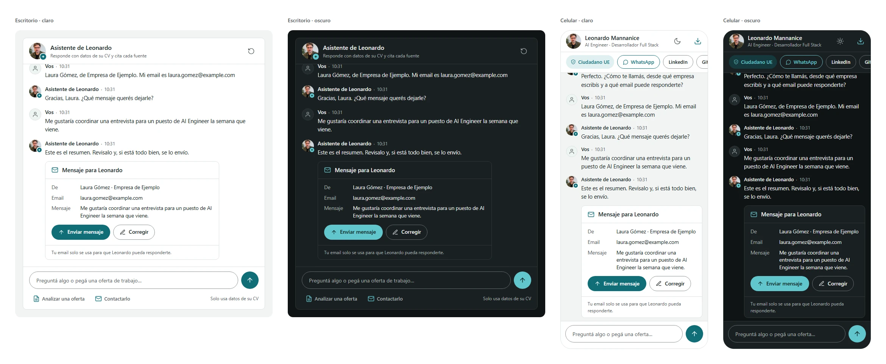

### 9 · Contact: message sent

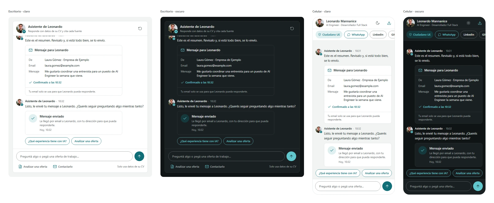

### 10 · Network error

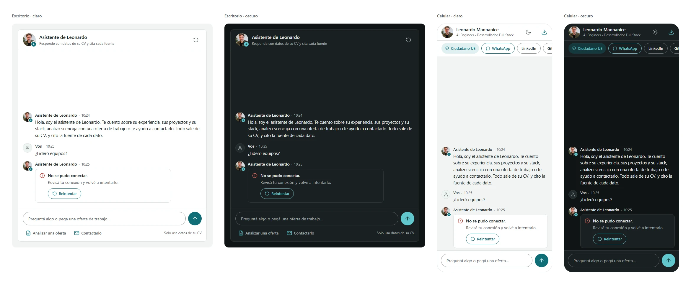

### 11 · Question limit

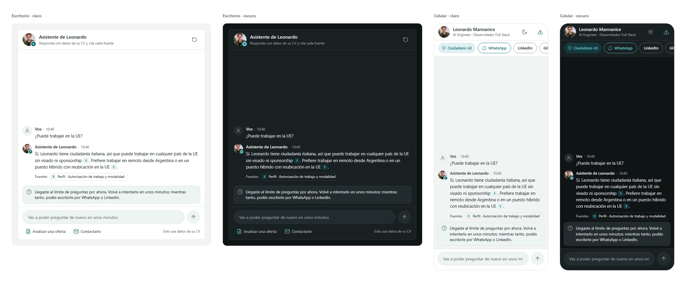

### 12 · Off-topic question

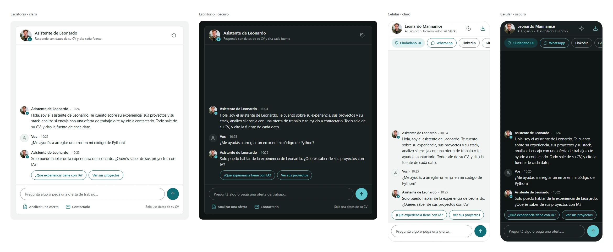

### 13 · Reserved topic

Salary and start date get a polite redirect to a direct conversation, following `content/policies.md`.


## Motion

Plain CSS transitions and keyframes, with no animation library (ADR-020). The sheet shows every animation twice: with full motion and with reduced motion.

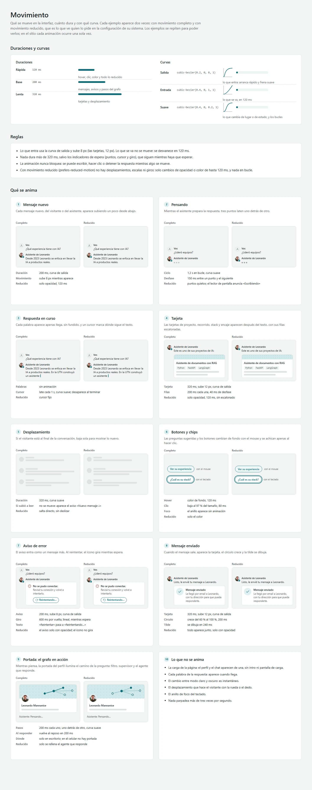

**Tokens**

| Token | Value | Use |
|---|---|---|
| `--duration-fast` | 120 ms | Hover, press, colour changes, and everything under reduced motion |
| `--duration-base` | 200 ms | Messages, notices and the steps of the cover graph |
| `--duration-slow` | 320 ms | Cards and scrolling |
| `--ease-out` | `cubic-bezier(0.2, 0, 0, 1)` | What enters: starts fast and settles |
| `--ease-in` | `cubic-bezier(0.4, 0, 1, 1)` | What leaves, in 120 ms |
| `--ease-move` | `cubic-bezier(0.4, 0, 0.2, 1)` | What moves or changes state, and loops |

**Rules**

- What enters uses `--ease-out` and rises 8 px as it fades in (cards rise 12 px). What leaves doesn't move: it fades out in 120 ms.
- Nothing lasts longer than 320 ms except the waiting indicators (dots, caret and spinner), which run while there is something to wait for.
- Animation never blocks: the visitor can type, click or stop the answer while something moves.
- Under `prefers-reduced-motion`, nothing moves, scales or rotates: only opacity and colour change, in 120 ms at most, and nothing loops.

| What | Full motion | Reduced motion |
|---|---|---|
| New message | 200 ms, rises 8 px, `--ease-out` | Opacity only, 120 ms |
| Typing dots | 1.2 s loop, each dot 150 ms after the previous one, `--ease-move` | Still dots; screen readers announce "Escribiendo" |
| Streaming answer | Words appear as they arrive, without fading; the caret pulses every 1 s and disappears at the end | Steady caret |
| Card | 320 ms, rises 12 px; its rows follow 40 ms apart, 200 ms each | Opacity only, 120 ms, no stagger |
| Auto-scroll | 320 ms, `--ease-move`, only when the visitor is already at the bottom; otherwise a "Nuevo mensaje ↓" button fades in | Jumps without sliding |
| Buttons and chips | Hover changes the background in 120 ms; pressing scales to 97 % in 80 ms | Colour only |
| Error notice | 200 ms, rises 8 px; while retrying, the icon spins at 600 ms per turn, linear, and the label becomes "Reintentando…" | Notice fades in; the icon doesn't spin |
| Message sent | Card 320 ms, rises 12 px; the circle grows from 60 % to 100 % in 200 ms; the tick draws in 240 ms | Everything appears together, opacity only |
| Cover graph | While thinking, the guardrail, the edge, a pulse on the supervisor, the next edge and the answering agent light up 200 ms apart; back to rest in 200 ms when the answer starts. Desktop only | Only the answering agent fills |

The graph follows the `node` events of the API (step 4.2), so it shows the real path through the agents, not a canned animation.

**Never animated:** the page load (the profile and the chat appear at once, with no intro or splash screen), each streamed word, the switch between light and dark mode, scrolling done by the visitor, and the keyboard focus ring. Nothing flashes more than three times per second.

## Copy and tone

Clear, short and honest; English first, Spanish second. The Spanish copy uses voseo (ADR-018).

1. **The assistant speaks about Leonardo in the third person:** "Leonardo led a team of 8 developers", never "I led…" (ADR-011).
2. **Every button says what it does, with a verb:** "Download CV", "Analyse a job offer", "Leave him a message".
3. **Short, concrete sentences:** no exclamation marks, no emojis, no sales adjectives such as "passionate" or "expert".
4. **Honest about what it doesn't know:** if a fact isn't in his CV, it says so and offers to ask Leonardo.
5. **Errors say what happened and what to do:** one sentence for the problem and one for the way out, with no technical codes.

| Where | English | Spanish (voseo) |
|---|---|---|
| Question box | Ask anything or paste a job offer… | Preguntá algo o pegá una oferta de trabajo… |
| Visitor's name | You | Vos |
| No connection | Couldn't connect. Check your connection and try again. | No se pudo conectar. Revisá tu conexión y volvé a intentarlo. |
| Question limit | You've reached the question limit for now. Try again in a few minutes. | Llegaste al límite de preguntas por ahora. Volvé a intentarlo en unos minutos. |
| Off-topic | I can only talk about Leonardo's experience. Would you like to hear about his AI projects? | Solo puedo hablar de la experiencia de Leonardo. ¿Querés saber de sus proyectos con IA? |
| Fact not in the CV | That isn't in his CV. I can help you ask him directly. | Eso no figura en su CV. Si querés, te ayudo a preguntárselo a él. |
| Message sent | Done, I've sent your message to Leonardo. | Listo, le envié tu mensaje a Leonardo. |

## Accessibility

- **Contrast:** WCAG AA for all text in both themes, and 3:1 for control borders (see [Colour](#colour)).
- **Focus:** a 2 px `--accent` outline with a 2 px offset on every interactive element. It appears instantly, without animation.
- **Targets:** primary controls are 40 to 46 px; chips and small buttons are at least 36 px high.
- **Screen readers:**
  - the message list is `aria-live="polite"`;
  - the typing dots and the question-limit notice are `role="status"`, and errors are `role="alert"`;
  - icon-only buttons have labels: send question, stop answer, new conversation, switch theme, download CV;
  - the question box has a visually hidden label;
  - each citation badge's accessible name includes its source.
- **Images:** the profile photo has the alt text "Retrato de Leonardo Mannanice" ("Portrait of Leonardo Mannanice"). Avatars next to a name, the badge, the cover and decorative icons are hidden from assistive technology.
- **Motion:** reduced motion as specified in [Motion](#motion).
